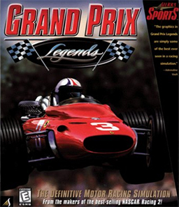
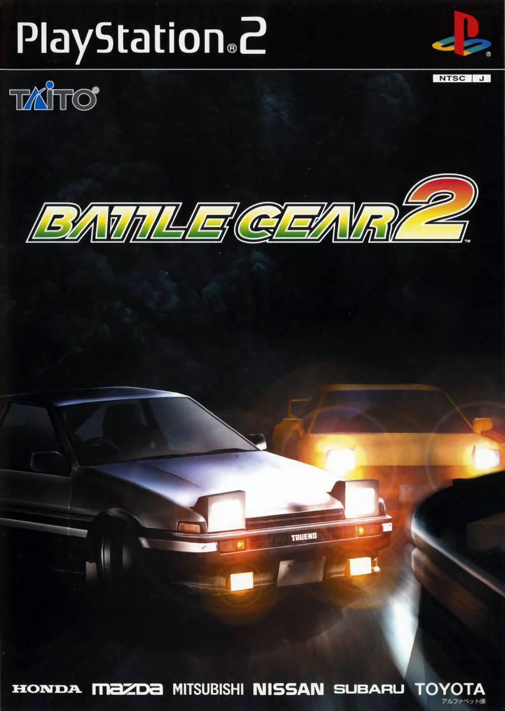

# grand-prix-legends-battle-gear-2-psx
## Grand Prix Legends – Battle Gear 2 PSX Remake
A remake of Battle Gear (1998), rebuilt using the Grand Prix Legends engine, combining its realistic driving physics, vintage racing atmosphere, historic circuits, and classic Formula One presentation with Battle Gear's arcade-style racing, Japanese street circuits, high-speed competition, and diverse selection of racing cars.

## Github Treeview
[https://treegit.macosxjs.com/?url=igiteam/grand-prix-legends-battle-gear-2-psx](https://treegit.macosxjs.com/?url=igiteam/grand-prix-legends-battle-gear-2-psx)

## Github Tree Api Direct JSON
[https://api.github.com/repos/igiteam/grand-prix-legends-battle-gear-2-psx/git/trees/main?recursive=1](https://api.github.com/repos/igiteam/grand-prix-legends-battle-gear-2-psx/git/trees/main?recursive=1)

## Base Gameplay

## WS11WineCX20.0.4 (macOS Big Sur 32-bit)

[WS11WineCX20.0.4.tar.7z](https://github.com/vitor251093/porting-kit-engines/releases/download/wineskin/WS11WineCX20.0.4.tar.7z)

## Reference Links
[http://www.gplworld.de/en/grand-prix-legends/gpl-mods](http://www.gplworld.de/en/grand-prix-legends/gpl-mods)

[https://steamcommunity.com/groups/GrandPrixLegends/discussions/0/143388132202581628/](https://steamcommunity.com/groups/GrandPrixLegends/discussions/0/143388132202581628/)

[https://archive.org/details/grand-prix-legends](https://archive.org/details/grand-prix-legends)

[https://archive.org/details/battle-gear-2-ntsc-j](https://archive.org/details/battle-gear-2-ntsc-j)

## Dev Environment

**Official White Wii Remote With Nunchuk — Tested And Working — £14.99**
[https://www.ebay.co.uk/itm/800847189353](https://www.ebay.co.uk/itm/800847189353)

**Infrared Sensor Bar USB for Wii Emulator Remote Motion Detection Setup — £6.69**
[https://www.ebay.co.uk/itm/227423830875](https://www.ebay.co.uk/itm/227423830875)

**Apple MacBook Pro Retina 15in (2014) i7 2.8GHz 16GB 1TB SSD GT 750M — £120.30**
[https://www.ebay.co.uk/itm/800844561513](https://www.ebay.co.uk/itm/800844561513)

**WS11WineCX20.0.4 (Wine engine)**
[https://igiteam.github.io/wine_engines/](https://igiteam.github.io/wine_engines/)

**Official Genuine Sony PS3 PlayStation 3 DualShock 3 Wireless Controller Black — £19.99**
[https://www.ebay.co.uk/itm/840031043465](https://www.ebay.co.uk/itm/840031043465)

**Amazon Basics 4K HDMI Cable 3m — 18Gbps High Speed with Ethernet, 4K@60Hz, 2160p — £8.44**
[https://www.ebay.co.uk/itm/327352257557](https://www.ebay.co.uk/itm/327352257557)

**wiimote_nunchuk_macosx**
[https://github.com/igiteam/wiimote-nunchuk](https://github.com/igiteam/wiimote-nunchuk)

**xbox360_input_gui_py**
[https://github.com/igiteam/xbox360_input_gui_py](https://github.com/igiteam/xbox360_input_gui_py)

**logitec_mx_mouse_3_macos**
[https://github.com/igiteam/logitec_mx_mouse_3_macos](https://github.com/igiteam/logitec_mx_mouse_3_macos)

**igi1-macbook-3d-workstation**
[https://github.com/igiteam/igi1-macbook-3d-workstation](https://github.com/igiteam/igi1-macbook-3d-workstation)

---
